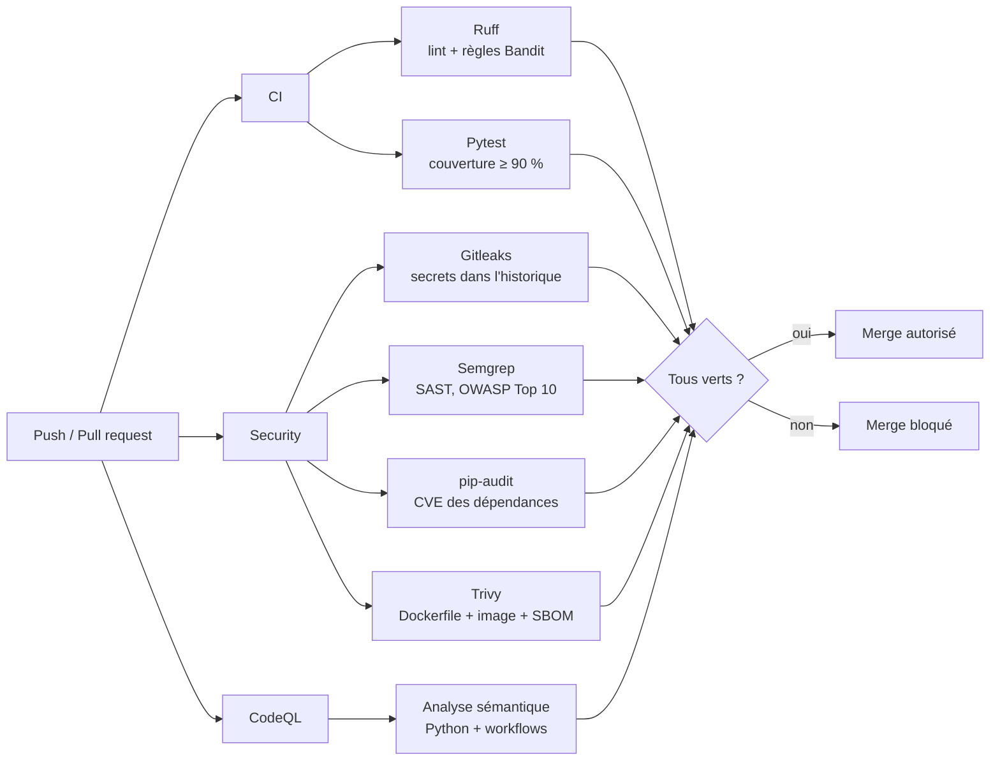
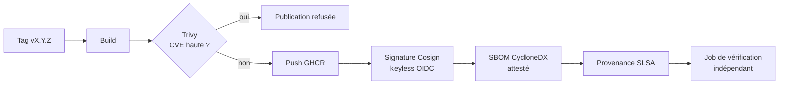

# secure-cicd-pipeline

[](https://github.com/voidsponge/secure-cicd-pipeline/actions/workflows/ci.yml)
[](https://github.com/voidsponge/secure-cicd-pipeline/actions/workflows/security.yml)
[](https://github.com/voidsponge/secure-cicd-pipeline/actions/workflows/codeql.yml)
[](https://github.com/voidsponge/secure-cicd-pipeline/actions/workflows/release.yml)

Un pipeline CI/CD **secure-by-default** autour d'une petite API Flask (SecureNotes).
Chaque push et chaque pull request passe par une série de contrôles de sécurité automatisés,
et **une PR qui introduit une faille ne peut pas être mergée**.

L'objectif est de montrer une démarche DevSecOps « shift-left » : trouver les problèmes
au moment où le code est écrit, pas en production.

## Ce que fait le pipeline



| Contrôle | Outil | Ce qu'il détecte | Bloquant |
|---|---|---|---|
| Lint sécurité | Ruff (règles `S`, portage de Bandit) | `eval`, `subprocess` avec shell, mots de passe en dur… | Oui |
| Tests | Pytest + pytest-cov | Régressions, dont des tests d'injection SQL et de validation d'entrées | Oui (< 90 %) |
| Secrets | Gitleaks | Clés API, tokens, mots de passe, **sur tout l'historique git** | Oui |
| SAST | Semgrep | Injections, XSS, désérialisation, mauvaises pratiques Flask et Docker | Oui (sévérité ERROR) |
| SAST sémantique | CodeQL (`security-extended`) | Flux de données de l'entrée utilisateur vers une fonction dangereuse | Via les règles de protection |
| Dépendances | pip-audit | CVE connues dans les paquets Python | Oui |
| Conteneur | Trivy | Mauvaise config du Dockerfile, CVE de l'image | Oui (HIGH/CRITICAL corrigeables) |
| SBOM | Trivy (CycloneDX) | Inventaire de tous les composants de l'image | Non, publié en artefact |
| Mises à jour | Dependabot | Nouvelles versions de pip, des actions et de l'image de base | PR automatiques |

Les résultats de Semgrep, Trivy et CodeQL sont envoyés au format SARIF dans l'onglet
**Security → Code scanning** du repo, et apparaissent directement en commentaire sur les lignes
concernées dans les pull requests.

## Le pipeline est lui-même sécurisé

Un pipeline CI est une cible d'attaque à part entière (voir les compromissions de
`tj-actions/changed-files` ou de `trivy-action`). Les choix faits ici :

- **Actions épinglées par SHA de commit**, pas par tag : un tag peut être déplacé par un attaquant,
  un SHA non. Dependabot met à jour les SHA chaque semaine.
- **Image Docker de base épinglée par digest** (`python:3.13-slim@sha256:…`).
- **Outils de scan figés en version** (`semgrep/semgrep:1.182.0`, `aquasec/trivy:0.76.1`).
- **Permissions minimales** : `contents: read` par défaut, `security-events: write` seulement
  pour les jobs qui publient du SARIF.
- **`persist-credentials: false`** sur chaque checkout, pour que le token ne traîne pas sur le disque.
- **Timeouts** sur chaque job et `concurrency` pour annuler les runs obsolètes.
- **Scan hebdomadaire planifié** : une nouvelle CVE peut toucher du code qui n'a pas changé.

### Premier vrai résultat

Dès son premier passage, Trivy a bloqué le pipeline : l'image `python:3.13-slim` contenait
1 CVE critique et 4 hautes (`certifi`, `urllib3`, `msgpack`, `setuptools`), toutes embarquées
par `pip` lui-même et jamais utilisées par l'application. Correctif : désinstaller `pip`,
`setuptools` et `ensurepip` de l'image finale, ce qui réduit aussi la surface d'attaque.

## L'application

SecureNotes est volontairement simple, mais écrite proprement :

- requêtes SQL **paramétrées** uniquement ;
- validation stricte des entrées (type, longueur) et taille de requête limitée à 16 Ko ;
- en-têtes de sécurité (CSP, HSTS, `X-Frame-Options`, `nosniff`, `Referrer-Policy`) ;
- conteneur exécuté en **utilisateur non root**, avec healthcheck.

| Méthode | Route | Description |
|---|---|---|
| `GET` | `/health` | État du service |
| `GET` | `/notes` | Liste des notes |
| `GET` | `/notes/<id>` | Une note |
| `POST` | `/notes` | Crée une note `{"title": "...", "body": "..."}` |
| `DELETE` | `/notes/<id>` | Supprime une note |

## Lancer en local

```bash
python -m venv .venv && source .venv/bin/activate
pip install -r requirements-dev.txt

ruff check . && ruff format --check .   # lint + règles de sécurité
pytest                                  # tests + couverture
pip-audit -r requirements.txt           # CVE des dépendances
```

Avec Docker :

```bash
docker build -t securenotes .
docker run --rm -p 8000:8000 securenotes
curl -X POST localhost:8000/notes -H 'Content-Type: application/json' -d '{"title":"hello","body":"world"}'
```

## Voir le pipeline bloquer une faille

La démo la plus parlante : ouvrir une PR qui introduit volontairement une vulnérabilité et
regarder le pipeline la refuser. La marche à suivre est dans [docs/demo.md](docs/demo.md).

## Activer le blocage du merge

Les workflows signalent les problèmes, mais c'est la protection de branche qui empêche le merge.
La configuration est décrite dans [docs/branch-protection.md](docs/branch-protection.md).

## Livraison signée et vérifiable

Chaque tag `vX.Y.Z` déclenche le workflow [Release](.github/workflows/release.yml) :



- **Aucune clé à gérer** : Cosign signe avec un certificat éphémère émis par Sigstore à partir du
  jeton OIDC de GitHub Actions. La signature est inscrite dans le journal public Rekor.
- La signature prouve **qui** a construit l'image (ce workflow, sur ce repo, pour ce tag),
  le SBOM dit **ce qu'elle contient**, la provenance SLSA dit **comment** elle a été construite.
- Un second job revérifie tout, en n'acceptant que ce workflow comme signataire.

Vérifier une image soi-même :

```bash
IMAGE=ghcr.io/voidsponge/secure-cicd-pipeline:v1.0.0

cosign verify "$IMAGE" \
  --certificate-oidc-issuer https://token.actions.githubusercontent.com \
  --certificate-identity-regexp '^https://github.com/voidsponge/Secure-CICD-Pipeline/\.github/workflows/release\.yml@refs/tags/v'

gh attestation verify "oci://$IMAGE" --repo voidsponge/Secure-CICD-Pipeline
```

## Pistes d'évolution

- Refuser au déploiement toute image non signée (Kyverno ou Sigstore policy-controller).
- Scan dynamique (DAST) avec OWASP ZAP contre l'app lancée dans le pipeline.
- Image distroless multi-stage, sans shell ni gestionnaire de paquets.

## Licence

MIT
